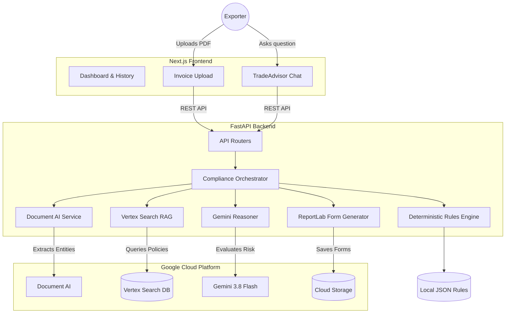
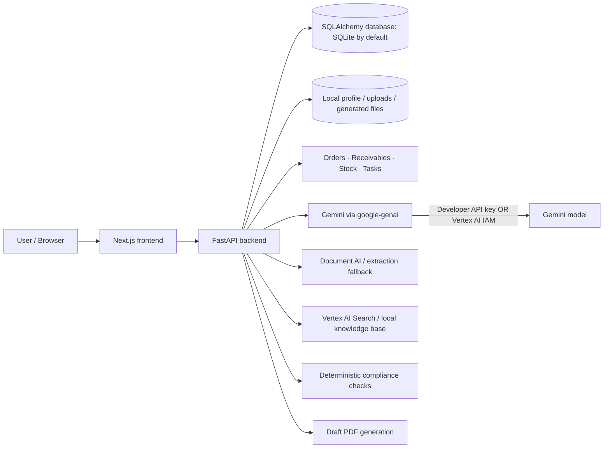

# ⚓ ShipSure: AI-Powered Trade Compliance & Customs Engine

**Built for the Google AI Builder Cup 2026**

ShipSure is an intelligent, serverless application designed to completely automate cross-border trade compliance for Indian manufacturers and exporters. 

## 🚨 The Problem
Indian exporters face a labyrinth of regulations when shipping goods overseas:
- **SCOMET Guidelines:** Strict export controls on dual-use items (e.g., electronics, chemicals). Shipping a restricted item without authorization can lead to seized cargo and massive fines.
- **Missed FTA Benefits:** India has Free Trade Agreements (FTAs) like the India-UAE CEPA, but exporters often fail to claim duty concessions because parsing the complex HS Code rules is entirely manual.
- **Manual ICEGATE Paperwork:** Manually re-typing invoice data into the ICEGATE portal to generate Shipping Bills and Certificates of Origin is time-consuming and error-prone.

## 💡 The Solution
ShipSure acts as an AI Trade Compliance Officer:
1. **Ingestion:** Simply drag-and-drop a PDF Commercial Invoice. Google **Document AI** instantly extracts the line items, HS Codes, and consignee data.
2. **Deterministic Screening:** High-speed local validation against active FTAs and SCOMET lists.
3. **RAG + Reasoning:** Uses **Vertex AI Search** to retrieve relevant paragraphs from massive Indian trade policy PDFs, feeding them into **Gemini 3.8 Flash** to generate a comprehensive `Risk Report`.
4. **Automated Forms:** Dynamically generates ready-to-file ICEGATE Shipping Bills, End-User Undertakings (EUU), and Certificates of Origin as downloadable PDFs.
5. **TradeAdvisor Copilot:** A chat interface where exporters can ask complex regulatory questions, grounded directly in official DGFT/ICEGATE documents.

---

## 🏗️ System Architecture



---

## 💻 Technology Stack

### Frontend
* **Framework:** Next.js 16 (App Router + Turbopack)
* **Styling:** Tailwind CSS v4
* **Language:** TypeScript
* **Deployment:** Google Cloud Run (`shipsure-web`)

### Backend
* **Framework:** FastAPI (Python 3.11)
* **PDF Generation:** ReportLab
* **Deployment:** Google Cloud Run (`shipsure-api`)

### Google Cloud Infrastructure
* **Google Cloud Run:** Serverless container hosting for both frontend and backend.
* **Document AI:** Specialized "Invoice Parser" processor used to extract structured metadata from raw uploaded PDFs.
* **Vertex AI Search:** Enterprise search datastore acting as our RAG layer, indexing massive Indian trade policy PDFs (FTP 2023, SCOMET).
* **Vertex AI Gemini:** Gemini 3.8 Flash serves as the core reasoning engine.
* **Cloud Storage (GCS):** Stores uploaded invoices and generated compliance forms.

---

## ⚙️ Detailed Component Implementation

### A. Data Ingestion & Extraction (`document_ai.py`)
When a user uploads a commercial invoice, the backend sends the file bytes to **Google Document AI**. The `INVOICE_PROCESSOR` model identifies key entities regardless of the invoice's visual layout. 

### B. Deterministic Rule Screening (`deterministic.py`)
Before querying the LLM, the system performs high-speed deterministic screening:
1. **SCOMET Check:** Scans extracted HS Codes against all 9 SCOMET categories.
2. **FTA Eligibility:** Checks the destination country against FTAs (e.g., India-UAE CEPA) for duty savings.
3. **Port Validation:** Validates the Port of Loading against ICEGATE UN/LOCODE standard.

### C. RAG Context Retrieval (`vertex_search.py`)
Queries the **Vertex AI Search Datastore** to retrieve highly relevant policy snippets (like specific paragraphs from the DGFT Handbook) and returns them with exact relevance scores.

### D. LLM Risk Evaluation (`gemini.py`)
Compiles a massive prompt containing the extracted invoice data, deterministic flags, and RAG context. This is sent to **Gemini 3.8 Flash**, which synthesizes a final `RiskReport` with severity scores and policy citations.

### E. Automated Form Generation (`form_generator.py`)
The `reportlab` library dynamically draws and merges the user's saved **Company Profile** with the **Extracted Invoice Data** to generate Shipping Bills, Certificates of Origin, and End-User Undertakings (EUU).

### F. TradeAdvisor Copilot (`routers/advisor.py`)
A standalone chat interface that proxies directly to Vertex Search to find documents, then uses Gemini to summarize the answer and provide exact citations.

---

## 🚀 How to Run Locally

### Prerequisites
- Node.js (v20+)
- Python (v3.11+)
- Google Cloud CLI (`gcloud`) authenticated (`gcloud auth application-default login`)

### 1. Start the Backend
```bash
cd backend
python -m venv venv
source venv/bin/activate  # (or `venv\Scripts\activate` on Windows)
pip install -r requirements.txt
uvicorn main:app --reload --port 8000
```

### 2. Start the Frontend
```bash
cd frontend
npm install
npm run dev
```
Navigate to `http://localhost:3000`.

---

## ☁️ How to Deploy to Google Cloud Run

ShipSure is designed to run entirely serverless on Google Cloud Run. Deployment scripts are included in the root directory.

### 1. Deploy the Backend
Ensure your `.env` contains your GCP Project ID, Document AI Processor ID, and Vertex Search Datastore ID. 
Run the automated batch script:
```bash
./deploy_backend.bat
```
*(This sets the environment variables securely in Cloud Run and deploys the FastAPI container. It will output a live HTTPS URL.)*

### 2. Deploy the Frontend
Edit `frontend/.env.production` and set `NEXT_PUBLIC_API_URL` to the live backend URL you just received. Then run:
```bash
./deploy_frontend.bat
```
*(This compiles the Next.js static assets, bakes in the API URL, and deploys the React app to a public URL).*

---

## 📂 Repository Structure
* `/frontend` - Next.js React Application
* `/backend` - FastAPI Python Server
* `/knowledge-base` - Local JSON deterministic rule engines and data for FTAs/SCOMET
* `/test-data` - Sample Indian export invoices used for QA and hackathon demo scenarios

---

## Current implementation — company onboarding and chat workspace

Updated on 11 October 2026 for `feat/company-onboarding-chat-workspace`. This section records the current implementation; the earlier architecture and solution sections also describe intended capabilities. Features below were checked against source code, not verified against a live Google Cloud deployment.

### Implemented user flows

- **Company onboarding:** A three-step setup collects company/address details, IEC, GSTIN, PAN, AD code, loading port, and signatory details, followed by a review screen. Required-field and identifier-format validation runs in the frontend; identifiers are normalized before saving. Complete saved profiles skip onboarding, incomplete profiles return to setup, and failed loads/saves offer recovery without discarding entered values.
- **Company settings:** View and edit the saved profile. The backend reads and writes a single profile in `backend/data/company-profile.json`; generated forms use this profile.
- **Chat workspace:** The home and Trade Advisor views share a conversation and shipment panels. Requests such as “Create a new shipment”, “Show shipment history”, “Open my latest shipment”, and “Open company settings” trigger application actions. Shipment requests can match an ID, invoice number, or filename; otherwise they use the selected or latest record.
- **Shipment panels and navigation:** Open new-shipment, history, and shipment-detail panels alongside chat. Conversation and panel state survive route navigation during the current app session. Mobile users can switch between conversation and details, with a collapsible navigation menu.
- **Invoice upload and analysis:** Upload an invoice, inspect extracted data, and view a risk report with severity flags, recommendations, policy citations, required forms, and any returned duty-savings text. Backend analysis combines extraction, local SCOMET screening, policy search, and Gemini reasoning.
- **Shipment history:** List recorded uploads and open their details. Chat can summarize the selected or latest shipment using its stored invoice and compliance data. Empty history and request failures have distinct UI states and retry actions.
- **Trade Advisor:** General questions go to the advisor API, with recent conversation, company name, and the selected shipment supplied as context. Replies display returned sources, and failed requests can be retried.
- **PDF forms:** Generate or regenerate Shipping Bill, Certificate of Origin, and End User Undertaking PDFs for completed shipments, then download them from the detail view.

### Current limits and corrections to earlier sections

- The active Gemini service uses **`gemini-2.5-flash`**, rather than the model named in the earlier overview. Both analysis and advisor calls require working Vertex AI credentials even with `DEMO_MODE=true`; there is no offline Gemini response implementation. Analysis failures return an API-error risk report, while the chat UI treats advisor API-error replies as failed requests.
- `DEMO_MODE=true` uses uploaded JSON invoice data when parseable. Other files fall back to sample invoices selected by filename (`scomet`, `fta`, or the default clean sample), so demo PDF uploads do not extract their actual contents. Sample JSON invoices are in `test-data/invoices/`.
- Live Document AI currently maps only invoice number and supplier name. Full extraction of line items, HS codes, buyer, ports, and values from real PDFs remains incomplete.
- The analysis engine computes destination-country FTA matches, but does not pass those matches into Gemini or expose them in the stored shipment response. Port lookup exists as a helper but is not wired into the analysis pipeline. Local SCOMET matching uses configured HS-code prefixes and description keywords.
- Local policy-search fallback returns matching JSON filenames and scores, not actual policy passages. Live Vertex AI Search requires a configured datastore.
- Shipments and generated PDFs live in process-memory dictionaries and disappear on backend restart. Uploaded files and the company profile use local disk. GCS storage and a durable shipment database are not wired into these routes.
- Chat messages and panel state are held in React memory and reset on a full page reload. No confirmed dispatch, delivery, or carrier-tracking data is recorded.
- The re-analysis endpoint currently returns an acknowledgement without rerunning analysis. Generated PDFs are application-generated documents; direct ICEGATE filing is not implemented.
- The current profile storage is shared rather than per-account; authentication and per-user isolation are not implemented.

### Local startup clarification

Run the backend from the **repository root**, because its imports use the `backend` package:

```bash
python3 -m venv .venv
source .venv/bin/activate
pip install -r backend/requirements.txt
cp .env.example .env
python -m uvicorn backend.main:app --reload --port 8000
```

For live extraction/search, configure `DEMO_MODE=false`, `GCP_PROJECT_ID`, `GCP_PROCESSOR_ID`, `GCP_DATASTORE_ID`, and the appropriate `GCP_LOCATION` for Document AI in `.env`, together with Google Cloud credentials. The Gemini service currently uses `us-central1` directly. Demo extraction/search can run locally, but successful AI answers and risk analysis still need cloud access.

In a second terminal, start the frontend with the existing `cd frontend`, `npm install`, and `npm run dev` instructions. `NEXT_PUBLIC_API_URL` defaults to `http://localhost:8000`.

### Existing UI test coverage

`frontend/tests/workspace.spec.ts` contains six Playwright scenarios covering onboarding validation/save recovery, profile-load recovery, chat and route continuity, upload/form generation, empty/failed history, and mobile navigation. These tests mock the backend APIs and do not verify real extraction or cloud integrations.

To run them with frontend dependencies installed:

```bash
cd frontend
npm run build
npm run test:e2e
```

The Playwright configuration uses installed Chrome and starts the production frontend on port 3100. This documentation update did not run the UI suite; frontend dependencies were not present in the checkout.

### Ongoing documentation

As work continues on this branch, append dated entries here describing completed changes, validation performed, and remaining limitations.

- **11 October 2026:** Reviewed the onboarding/chat-workspace branch and added its implemented flows, existing test coverage, corrected backend startup command, and implementation limitations to this README. No application code changed.

- **11 October 2026 — Local run:** Installed frontend dependencies using Node 22.21.1 and backend dependencies in `backend/venv` using Python 3.12. Started the Next.js development server at `http://127.0.0.1:3000` and FastAPI at `http://127.0.0.1:8000`. Both servers reached ready state and the frontend served HTTP 200. No `.env` was present, so extraction/search use the default demo mode; cloud AI functionality still requires credentials.


## Submission readiness work — 16 October 2026

Work continues on `codex/submission-readiness`, created from `feat/company-onboarding-chat-workspace`. The current checkout includes the business operations workspace (orders, dispatches, receivables, payments, tasks, stock, GST preview, and a tool-using assistant) alongside export compliance. Earlier dated implementation notes describe older revisions and should not be taken as the current feature specification.

### Protecting demo reset

`POST /api/demo/reset` is disabled by default (404). For local development only, explicitly set `ENABLE_DEMO_RESET=true` and a nonempty `DEMO_RESET_TOKEN`; callers must provide that value in the `X-Demo-Reset-Token` header. Missing or invalid tokens return 403 without calling the reset operation. Leave reset disabled on the public judging deployment. This protection does not add authentication or tenant isolation to other business endpoints.

Backend test fixtures now reseed their isolated test database directly rather than relying on the public reset endpoint. Regression tests cover disabled reset, missing configuration/token, invalid token, and authorized reset. Run `backend/venv/bin/python -m pytest backend/tests -q` from the repository root. These tests use offline AI and a temporary SQLite database; they do not verify deployed cloud integrations.

### Pending verification

The pasted audit references an updated project ZIP and cloud-validation guide that have not been supplied to this checkout. Live Cloud Run URLs/configuration are also needed to verify the deployed app. The frontend deployment script currently does not explicitly supply `NEXT_PUBLIC_API_URL` at image build time. Local Google Cloud CLI was not found on PATH during this review. No deployment or cloud integration has been marked verified.


---

## Current full product scope — 16 October 2026

The following reviewed overview supersedes older implementation snapshots above.

# ShipSure — AI Operations Copilot for Indian Manufacturers & Exporters

**Team One Neuron · AI Builder Cup 2026**

ShipSure brings business operations and export-compliance assistance into one workspace. It helps a manufacturing/export business understand customer dues, purchase orders, dispatches, stock, GST-related reminders and shipment compliance, then act on that information through a conversational assistant. The product is a **prototype**, not an ERP replacement, government filing service, or certified compliance decision-maker.

## Why it exists

Small manufacturers and exporters often work across disconnected spreadsheets, invoices, purchase orders, and regulatory documents. ShipSure connects day-to-day operational records to contextual AI assistance and a specialized export-compliance workflow.

## Product capabilities and current maturity

| Area | What the code supports | Maturity / limitation |
|---|---|---|
| Company onboarding | Capture and retrieve a business profile | Implemented; single local JSON profile, not multi-tenant |
| Workspace dashboard | Prioritized inbox, business KPIs and tasks | Implemented over seeded/local business records |
| Orders and dispatches | List/create orders, capture PO, record dispatch, create invoice | Implemented; AI extraction depends on configured services |
| Receivables | Ageing, customer statements, payment recording and reminders | Implemented; uses local SQL database by default |
| Stock | Inventory and shortage overview | Implemented against demo records |
| GST | GST-related status/reminders | Preview; not a filing integration |
| Conversational operations | Gemini tool calling to query data and propose actions | Implemented; can fall back to deterministic offline responses |
| Export invoice ingestion | Upload/sample invoice extraction | Document AI and Gemini paths; demo fallback exists |
| Shipment screening | Rules, risk indicators, report and source retrieval | Implemented as decision support; not regulatory certification |
| TradeAdvisor | Policy-related question answering | Local retrieval or Vertex AI Search; Gemini availability required for live AI |
| Draft export forms | Generate/download supported PDF drafts | Partial; not government submission or filing |
| Authentication and multi-tenancy | — | Not implemented; use synthetic/demo data only |
| Persistent cloud storage | — | Not implemented by default; SQLite/files are ephemeral on Cloud Run |

**Not supported:** automatic ICEGATE filing, guaranteed legal compliance, and full end-user undertaking generation. Avoid presenting these as completed features.

## Architecture



The frontend and backend have separate Cloud Run deployment scripts. **Having scripts is not proof that a service is currently deployed or healthy.** The application currently relies on local files and SQLite unless explicitly configured otherwise.

## AI and Google Cloud integration

- **Gemini:** `backend/services/llm.py` uses the `google-genai` SDK. If `GEMINI_API_KEY` or `GOOGLE_API_KEY` is present, it selects the **Gemini Developer API**. Otherwise, it selects **Vertex AI** with `GCP_PROJECT_ID` and `GEMINI_LOCATION` using Application Default Credentials. `ASSISTANT_MODE=offline` disables AI calls. A status endpoint is available at `GET /api/assistant/status`, but it is **not proof that a successful Gemini request occurred**.
- **Document AI:** `backend/services/document_ai.py` uses `GCP_PROCESSOR_ID`, `GCP_PROJECT_ID` and `GCP_DOCAI_LOCATION`. When `DEMO_MODE=true`, it does not invoke Document AI.
- **Vertex AI Search:** `backend/services/vertex_search.py` uses `GCP_DATASTORE_ID` and `GCP_PROJECT_ID` when `DEMO_MODE=false`, but silently falls back to local search if the cloud call fails. Verify actual retrieval origin in logs before claiming live Search.
- **Cloud Run:** deployment scripts target `shipsure-api` and `shipsure-web` in `us-central1`. Confirm their URLs, revisions, environment, service accounts and logs independently.

**Note:** Some names in `backend/config.py` (`DOCUMENT_AI_PROCESSOR_ID`, `VERTEX_SEARCH_DATASTORE_ID`) differ from the environment variables consumed by integration services (`GCP_PROCESSOR_ID`, `GCP_DATASTORE_ID`). Use the latter for the current implementation.

## Run locally

Prerequisites: Python 3.11+, Node.js compatible with `frontend/package.json`, npm.

```bash
python -m venv .venv
source .venv/bin/activate  # Windows: .venv\Scripts\activate
pip install -r backend/requirements.txt
cp .env.example .env
python -m uvicorn backend.main:app --reload --port 8000
```

In another terminal:

```bash
cd frontend
npm ci
npm run dev
```

Open the frontend at `http://localhost:3000` and backend health at `http://localhost:8000/health`. Set `NEXT_PUBLIC_API_URL` for the frontend if the backend is not at localhost:8000. For a Cloud Run build, this variable must be available **at Next.js build time**, not merely as a runtime Cloud Run environment variable.

## Tests

```bash
python -m pytest backend/tests -q
cd frontend && npm ci && npx playwright install && npx playwright test
```

Backend tests use temporary SQLite, `ASSISTANT_MODE=offline`, and `DEMO_MODE=true`; passing tests does **not** establish that live Gemini, Document AI, Vertex AI Search, or Cloud Run work. See [VALIDATION.md](VALIDATION.md) for a cloud verification and browser test checklist.

## Demo safety and data

- The app has no user authentication or tenant isolation. Do not put real customer records or secrets in the public demo.
- `POST /api/demo/reset` is **disabled by default**. It requires `ENABLE_DEMO_RESET=true` **and** a matching secret in `X-Demo-Reset-Token` (`DEMO_RESET_TOKEN`). Keep reset disabled in the public service.
- Default SQLite and local filesystem writes are not durable across Cloud Run instance replacement and are not shared across replicas.
- Use demo records; never describe risk reports as legal advice or draft PDFs as government-filed documents.

## Deployment and productionization

The current scripts `deploy_backend.bat` and `deploy_frontend.bat` provide a starting point, **not a production-ready deployment pipeline**. Review them before execution. The backend script overwrites/deletes `Dockerfile`, uses a hard-coded project and passes configuration in deployment arguments. The frontend requires an explicit backend URL baked into its build.

For a reliable public prototype, recommended upgrades are: Cloud SQL (PostgreSQL) for structured business data, Cloud Storage for uploaded/generated documents and company profile, Secret Manager for secrets, least-privilege Cloud Run service identities, restricted CORS, proper schema migrations, and authentication/tenant scoping. These upgrades are **recommendations, not implemented features**.

## Project layout

- `frontend/`: Next.js workspace UI and Playwright tests
- `backend/routers/`: business, assistant, invoice and compliance APIs
- `backend/services/`: Gemini, Document AI, retrieval, deterministic checks, business logic
- `backend/models/`: Pydantic and SQLAlchemy data models
- `backend/tests/`: automated backend tests
- `knowledge-base/`: local reference data and policy knowledge
- `test-data/`: sample documents and fixtures
- `VALIDATION.md`: deployment and live integration verification guide

## Scope and responsible use

ShipSure is an engineering demonstration. AI responses can be inaccurate, local policy data can become stale, and screening outputs require professional review. Do not rely on it for filing, export-control determinations, or financial reconciliation without independent verification.


### Readiness fixes and verification — 16 October 2026

Reviewed the supplied audited ZIP against this branch, appended its full product overview, and imported the live-validation guide as [VALIDATION.md](VALIDATION.md). The reset endpoint is protected, and browser tests explicitly enable it only on their isolated backend.

Fixed live Search parsing that referenced a nonexistent SDK response field and would otherwise fall back to local retrieval. Added successful-provider logs for Gemini, Document AI, and Search to support live verification. Gemini status now identifies the configured provider and mode without treating them as proof of a successful request.

Prepared frontend Cloud Build configuration to supply the public backend URL at image build time, with a required Docker build argument. The frontend deploy script accepts backend URL and image path arguments. Backend deployment no longer overwrites/deletes the root Dockerfile and explicitly disables reset. Build ignore files omit local databases, generated files, credentials, and dependencies. These deployment changes have not been executed in Google Cloud.


### Validation results — 16 October 2026

- Backend: **37 tests passed**, including reset authorization, Search SDK response parsing, Gemini provider selection, and success-log privacy checks.
- Browser: **10 Playwright workflows passed** against a real isolated backend with offline AI, a temporary SQLite database, and mocked company profile requests. Test-only reset requires its test token; backend and browser dates are fixed together for deterministic date validation.
- Frontend lint: passed.
- Production build: passed using `next build --webpack`. Default Turbopack hit an internal worker-port permission restriction in this local environment; a first sandboxed build also could not download the Google font. The application compiled and type-checked successfully through webpack. Docker/Cloud Build execution remains unverified.
- `git diff --check`: passed.
- Public cloud integration tests: pending authenticated Google Cloud access.


### Live Cloud Run inspection — 16 October 2026

Authenticated console access succeeded. Both services are marked healthy in `us-central1`; their overview last-update timestamps are 27 September 2026. Public endpoints discovered from service details:

- Frontend: https://shipsure-web-117561127510.us-central1.run.app
- Backend: https://shipsure-api-117561127510.us-central1.run.app

Backend `/health` returned HTTP 200 with `demo_mode=false`. Frontend returned HTTP 200 and rendered the older shipment-compliance dashboard, without the current business workspace. `/api/assistant/status` returned HTTP 404. The public deployment therefore does not represent the current local branch.

A synthetic policy question to `/api/advisor/chat` returned HTTP 503 after approximately 20 seconds. Cloud Run logs independently show the matching 503 request, a Gunicorn `WORKER TIMEOUT`, worker termination and service restart around that request. This establishes a deployed worker failure; it does not establish whether Gemini credentials, Document AI or Search permissions are valid. No successful live AI/extraction/search invocation has been verified.

The API container configuration lists `DEMO_MODE`, `GCP_PROJECT_ID`, `GCP_LOCATION`, `GCP_PROCESSOR_ID`, and `GCP_DATASTORE_ID`, with no API-key variable or secret binding visible in that panel. This is consistent with IAM-based cloud configuration but is not proof of the SDK/provider used by the older deployed image. No Cloud SQL connection or mounted volume was listed in the API container configuration.

No cloud configuration, permissions, or deployed image was changed during this inspection. Next release work must deploy the reviewed branch and verify cloud calls and worker responsiveness before marking the application ready.


### Reviewed deployment started — 16 October 2026

Moved synchronous Vertex Search and Document AI work to worker threads so cloud RPCs do not block the async server event loop. Search has a 15-second RPC deadline without automatic retries; Document AI has a 30-second deadline; Gemini requests have a 45-second async deadline and use existing fallback handling. A regression test verifies that slow Search leaves the event loop responsive. All 38 backend tests pass.

Prepared `infra/deploy-reviewed.sh` and uploaded a filtered source archive to authenticated Google Cloud Shell (SHA256 `8040014f5fee12c72c34c036308bd3e2a60fe86212049d31818c6c79efbc532e`). The archive contains current working-tree changes, including uncommitted readiness fixes; it is not represented as a committed Git release. Rollback revisions observed before deployment: API `shipsure-api-00010-llp`, web `shipsure-web-00002-f89`. The deployment retains existing IAM/service identities, disables reset, sets the frontend CORS origin, and limits the backend to one instance while it still uses local demo storage. A single instance does not make storage durable.


### Reviewed release — deployment results

Both services were built and deployed from the reviewed working tree. The public frontend is https://shipsure-web-117561127510.us-central1.run.app and the API is https://shipsure-api-117561127510.us-central1.run.app. Current revisions after the approved IAM fix are **API `shipsure-api-00012-drj`** and **web `shipsure-web-00003-47g`**, each serving 100% of traffic. Backend build: `5e1014b4-8399-4789-b7ed-6fe00ac1a31e`; frontend build: `d5955d10-c3a2-417e-86e5-111f65996907`. Frontend image digest: `sha256:1057cc434827d70634e2615c713765b929effb41b4c6131b15e472d412f713ee`.

Live calls initially exposed explicit IAM denials, rather than missing local credentials. With the user's explicit approval, created project custom role `shipsureRuntimeCaller` and bound it to the existing runtime identity `117561127510-compute@developer.gserviceaccount.com`. Its only permissions are `aiplatform.endpoints.predict`, `documentai.processors.processOnline`, and `serviceusage.services.use`. No storage, deployment, or IAM administration permission was added. `infra/grant-runtime-ai-access.sh` records the approved one-time setup; it is not part of the automatic deployment script. The runtime identity is shared with other workloads that use this service account.

Verified live:

- Public frontend renders the new operations workspace and calls the deployed API. Browser chat returned an AI answer about late orders and opened the correct order panel. No browser console errors were captured during this check.
- Assistant Gemini provider is **Vertex AI**. A real tool-calling response returned `mode=ai`, the correct ₹10,54,340 past-45-day total and ledger/customer citations. Successful `provider=vertex_ai` Gemini requests are independently recorded in Cloud Logging. The first measured tool workflow took about 33 seconds including startup; this is not a steady-state latency benchmark.
- Vertex AI Search logged `policy_search provider=vertex_search outcome=success results=1` and returned a datastore source. This verifies the cloud query path, not the completeness of policy snippets or regulatory coverage.
- A newly generated synthetic PDF completed invoice analysis (`status=complete`, risk report `mode=ai`). Extracted invoice `SS-VALIDATION-001`, buyer `Example Import Test LLC`, USD 1,000 total, and 100 brake pads at USD 10 with HS 87083000 matched the synthetic input. Cloud logs show a successful Document AI RPC, followed by Gemini extraction. **The final extracted fields in this test came through the Gemini fallback; Document AI-only extraction quality remains unverified.**
- Shipping Bill and Certificate of Origin drafts generated successfully. Certificate download returned HTTP 200 and a valid one-page PDF.
- Public demo reset returns 404.
- Health returned HTTP 200 in about 0.54 seconds while extraction and browser AI requests were in progress. An earlier 10-second health probe during initial rollout timed out; the later concurrent check succeeded.
- All 38 local backend tests passed; earlier validation also passed 10 isolated browser tests, frontend lint, and production build. The cloud frontend built successfully with its default Turbopack build.

Remaining limits: structured data, profiles, uploads, and PDFs still use ephemeral local storage, despite the backend's single-instance cap. This release is a synthetic-data demo without authentication/tenant isolation. Persistent cloud storage, a fresh multi-user security review, and broader real-document accuracy/latency validation are not completed by this deployment. Cloud Build also reports that its service account lacks Logs Writer; builds succeeded and their terminal output was available, but that additional IAM role was not granted.


## Durable storage implementation — 17 October 2026

Added PostgreSQL/Cloud SQL IAM connection support and a private GCS/local object-storage adapter for profiles, invoices, and PDFs. Durable mode refuses local fallback, database pools are bounded, initial PostgreSQL seeding is serialized, and demo reset cannot drop PostgreSQL tables. Cloud storage outages return recoverable errors instead of silently resetting onboarding. Downloads remain behind the existing API.

The current public deployment still uses ephemeral storage. No paid database/bucket or additional IAM access has been created. See [PERSISTENCE.md](PERSISTENCE.md) for the concrete proposed resources, cost allowance, database-privilege setup, preservation/cutover gates, and test limitations. PostgreSQL connectivity is not yet live-verified.

Persistence validation: **53 backend tests and 10 isolated browser workflows passed**. Cloud SQL connector setup is mocked; live PostgreSQL/GCS restart verification remains an activation gate.


### Cost constraint — 17 October 2026

The user declined paid Cloud SQL provisioning and requested a free-tier hackathon prototype. Do not create the proposed SQL instance or apply its IAM/storage provisioning plan. Preserve existing public demo data during any replacement. The PostgreSQL implementation remains local and unactivated. Reassess persistence against free-tier services; a Firestore migration would require adapting the current relational business logic and must not be represented as a drop-in database-URL change.

### 2026-10-17 — Free-allowance persistence preparation

Prepared a bounded Firestore persistence adapter and private object storage path for the hackathon; the paid Cloud SQL proposal is superseded. Preserved the current public demo with a read-only API backup (11 orders, six customer statements; no currently available shipments/PDFs). Migration verifies orders, full statements, payments, stock, tasks and GST, refuses overwrites and checks readback. Concurrent writes fail visibly instead of losing payments. See [FIRESTORE.md](FIRESTORE.md) for limits and activation steps. Cloud activation and IAM grants are still pending; the live application has not been switched. Free allowances do not guarantee a zero bill, particularly for existing AI services.

### 2026-10-17 — Firestore and private storage are live

Activated the approved default Firestore database and private `us-central1` Cloud Storage bucket, with no Cloud SQL instance. Backend `shipsure-api-00014-rov` and frontend `shipsure-web-00004-wpp` now serve 100% of traffic. Both use request-based billing, zero minimum instances and a one-instance revision maximum for the demo.

Preserved the original 11 orders, six customer statements, company profile, payments, stock, tasks and GST records. The old SQLite instance reseeded with next-day dates during the final check; those differences were reconciled and both snapshots retained. Firestore keeps the original historical dates while ageing calculations advance normally. Created one synthetic sample invoice/PDF and a completed persistence-verification task; these survived a new revision and the overnight cold start. Public API health, preserved totals/profile, order count, PDF checksum and disabled reset passed. Assistant status reports Vertex AI available with `gemini-2.5-flash` in automatic mode. **61 backend tests pass**; the prior 10-browser-workflow suite remains the UI baseline, with live orders and shipment checks for this release. See [FIRESTORE.md](FIRESTORE.md) for the bounded demo design, backups and cost limits. Free allowances are not a billing cap, and existing AI usage may still be billed.

### 2026-10-17 — Submission presentation and Git readiness

Created an editable 14-slide PowerPoint in the supplied AI Builder Cup format at `output/presentations/ShipSure_AI_Builder_Cup_Submission.pptx`. It includes the One Neuron team details, product idea, features, process and architecture diagrams, cost assumptions, real prototype screenshots, verification evidence, future work and submission links. The demo-video link remains pending. The configured GitHub repository is the intended submission destination, but public access was not verified (unauthenticated GitHub API returned 404).

Fresh readiness checks: **61 backend tests**, **10 isolated browser workflows**, **ESLint**, and a **Webpack production build** passed. The default local Turbopack build hit a host permission error when starting its helper process; `npm run build -- --webpack` completed with network access for the configured Google font. Browser tests now intercept API requests regardless of the URL baked into the frontend build, and explicitly select isolated SQLite storage. This fixes a missed company-profile mock and prevents those tests from calling a configured live API. Private slide-build files are ignored by Git. No commit or push was performed; the current branch is `codex/submission-readiness`.
