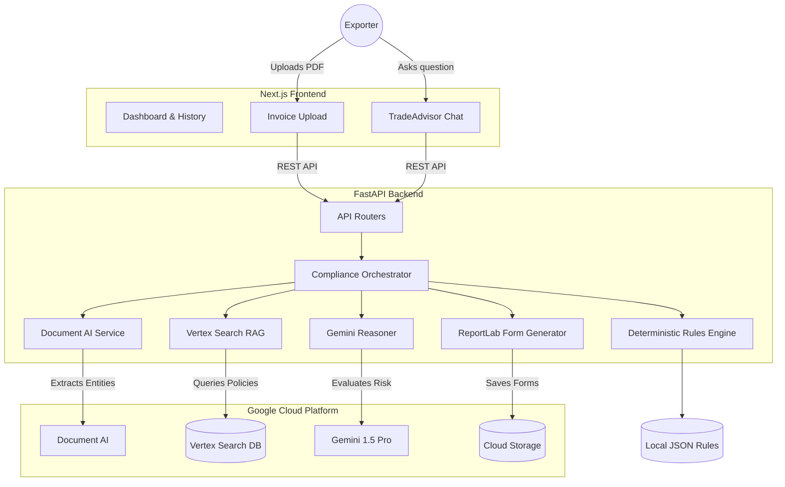

# ⚓ ShipSure: AI-Powered Trade Compliance & Customs Engine

**Built for the Google AI Builder Cup 2026**

ShipSure is an intelligent, serverless application designed to completely automate cross-border trade compliance for Indian manufacturers and exporters. 

## 🚨 The Problem
Indian exporters face a labyrinth of regulations when shipping goods overseas:
- **SCOMET Guidelines:** Strict export controls on dual-use items (e.g., electronics, chemicals). Shipping a restricted item without authorization can lead to seized cargo and massive fines.
- **Missed FTA Benefits:** India has Free Trade Agreements (FTAs) like the India-UAE CEPA, but exporters often fail to claim duty concessions because parsing the complex HS Code rules is entirely manual.
- **Manual ICEGATE Paperwork:** Manually re-typing invoice data into the ICEGATE portal to generate Shipping Bills and Certificates of Origin is time-consuming and error-prone.

## 💡 The Solution
ShipSure acts as an AI Trade Compliance Officer:
1. **Ingestion:** Simply drag-and-drop a PDF Commercial Invoice. Google **Document AI** instantly extracts the line items, HS Codes, and consignee data.
2. **Deterministic Screening:** High-speed local validation against active FTAs and SCOMET lists.
3. **RAG + Reasoning:** Uses **Vertex AI Search** to retrieve relevant paragraphs from massive Indian trade policy PDFs, feeding them into **Gemini 1.5 Pro** to generate a comprehensive `Risk Report`.
4. **Automated Forms:** Dynamically generates ready-to-file ICEGATE Shipping Bills, End-User Undertakings (EUU), and Certificates of Origin as downloadable PDFs.
5. **TradeAdvisor Copilot:** A chat interface where exporters can ask complex regulatory questions, grounded directly in official DGFT/ICEGATE documents.

---

## 🏗️ System Architecture



---

## 💻 Technology Stack

### Frontend
* **Framework:** Next.js 16 (App Router + Turbopack)
* **Styling:** Tailwind CSS v4
* **Language:** TypeScript
* **Deployment:** Google Cloud Run (`shipsure-web`)

### Backend
* **Framework:** FastAPI (Python 3.11)
* **PDF Generation:** ReportLab
* **Deployment:** Google Cloud Run (`shipsure-api`)

### Google Cloud Infrastructure
* **Google Cloud Run:** Serverless container hosting for both frontend and backend.
* **Document AI:** Specialized "Invoice Parser" processor used to extract structured metadata from raw uploaded PDFs.
* **Vertex AI Search:** Enterprise search datastore acting as our RAG layer, indexing massive Indian trade policy PDFs (FTP 2023, SCOMET).
* **Vertex AI Gemini:** Gemini 1.5 Pro serves as the core reasoning engine.
* **Cloud Storage (GCS):** Stores uploaded invoices and generated compliance forms.

---

## ⚙️ Detailed Component Implementation

### A. Data Ingestion & Extraction (`document_ai.py`)
When a user uploads a commercial invoice, the backend sends the file bytes to **Google Document AI**. The `INVOICE_PROCESSOR` model identifies key entities regardless of the invoice's visual layout. 

### B. Deterministic Rule Screening (`deterministic.py`)
Before querying the LLM, the system performs high-speed deterministic screening:
1. **SCOMET Check:** Scans extracted HS Codes against all 9 SCOMET categories.
2. **FTA Eligibility:** Checks the destination country against FTAs (e.g., India-UAE CEPA) for duty savings.
3. **Port Validation:** Validates the Port of Loading against ICEGATE UN/LOCODE standard.

### C. RAG Context Retrieval (`vertex_search.py`)
Queries the **Vertex AI Search Datastore** to retrieve highly relevant policy snippets (like specific paragraphs from the DGFT Handbook) and returns them with exact relevance scores.

### D. LLM Risk Evaluation (`gemini.py`)
Compiles a massive prompt containing the extracted invoice data, deterministic flags, and RAG context. This is sent to **Gemini 1.5 Pro**, which synthesizes a final `RiskReport` with severity scores and policy citations.

### E. Automated Form Generation (`form_generator.py`)
The `reportlab` library dynamically draws and merges the user's saved **Company Profile** with the **Extracted Invoice Data** to generate Shipping Bills, Certificates of Origin, and End-User Undertakings (EUU).

### F. TradeAdvisor Copilot (`routers/advisor.py`)
A standalone chat interface that proxies directly to Vertex Search to find documents, then uses Gemini to summarize the answer and provide exact citations.

---

## 🚀 How to Run Locally

### Prerequisites
- Node.js (v20+)
- Python (v3.11+)
- Google Cloud CLI (`gcloud`) authenticated (`gcloud auth application-default login`)

### 1. Start the Backend
```bash
cd backend
python -m venv venv
source venv/bin/activate  # (or `venv\Scripts\activate` on Windows)
pip install -r requirements.txt
uvicorn main:app --reload --port 8000
```

### 2. Start the Frontend
```bash
cd frontend
npm install
npm run dev
```
Navigate to `http://localhost:3000`.

---

## ☁️ How to Deploy to Google Cloud Run

ShipSure is designed to run entirely serverless on Google Cloud Run. Deployment scripts are included in the root directory.

### 1. Deploy the Backend
Ensure your `.env` contains your GCP Project ID, Document AI Processor ID, and Vertex Search Datastore ID. 
Run the automated batch script:
```bash
./deploy_backend.bat
```
*(This sets the environment variables securely in Cloud Run and deploys the FastAPI container. It will output a live HTTPS URL.)*

### 2. Deploy the Frontend
Edit `frontend/.env.production` and set `NEXT_PUBLIC_API_URL` to the live backend URL you just received. Then run:
```bash
./deploy_frontend.bat
```
*(This compiles the Next.js static assets, bakes in the API URL, and deploys the React app to a public URL).*

---

## 📂 Repository Structure
* `/frontend` - Next.js React Application
* `/backend` - FastAPI Python Server
* `/knowledge-base` - Local JSON deterministic rule engines and data for FTAs/SCOMET
* `/test-data` - Sample Indian export invoices used for QA and hackathon demo scenarios