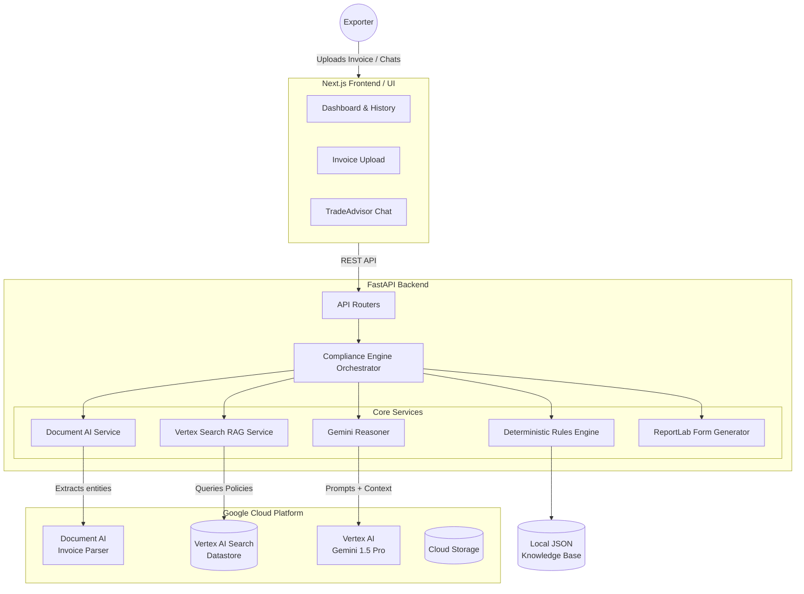

# 🏗️ ShipSure — High-Level Design (HLD)

## 📖 1. Overview
**ShipSure** is an AI-powered compliance and risk evaluation engine designed specifically for Indian manufacturers engaging in cross-border trade. It automates the ingestion of export invoices, screens them against complex Indian trade regulations (like SCOMET and FTAs), and automatically generates the required ICEGATE customs paperwork.

---

## 🏛️ 2. System Architecture

---

## 🛠️ 3. Technology Stack

### Frontend
* **Framework:** Next.js 16 (App Router + Turbopack)
* **Styling:** Tailwind CSS v4
* **Language:** TypeScript
* **Icons:** Lucide React
* **Deployment:** Google Cloud Run (`shipsure-web`)

### Backend
* **Framework:** FastAPI (Python 3.11)
* **Server:** Uvicorn + Gunicorn
* **PDF Generation:** ReportLab
* **Deployment:** Google Cloud Run (`shipsure-api`)

### Google Cloud Infrastructure (Phase 2 & 6)
* **Google Cloud Run:** Serverless container hosting for both frontend and backend.
* **Document AI:** Specialized "Invoice Parser" processor used to extract structured metadata (HS codes, item descriptions, consignee details) from raw uploaded PDFs or images.
* **Vertex AI Search:** Enterprise search datastore acting as our RAG (Retrieval-Augmented Generation) layer, indexing massive Indian trade policy PDFs (FTP 2023, SCOMET Appendix 3).
* **Vertex AI Gemini:** Gemini 1.5 Pro serves as the core reasoning engine, evaluating compliance risks based on the retrieved data and providing conversational advice via the TradeAdvisor interface.
* **Cloud Storage (GCS):** Stores uploaded invoices and generated compliance forms.

---

## ⚙️ 4. Detailed Component Implementation

### A. Data Ingestion & Extraction (`document_ai.py`)
When a user uploads a commercial invoice, the backend sends the file bytes to **Google Document AI**. The `INVOICE_PROCESSOR` model identifies key entities regardless of the invoice's visual layout. 
* *Fallback:* In `DEMO_MODE`, the system parses structured JSON representations of invoices.

### B. Deterministic Rule Screening (`deterministic.py`)
Before querying the LLM, the system performs high-speed deterministic screening using our local JSON knowledge bases.
1. **SCOMET Check:** Scans extracted HS Codes and item descriptions against all 9 SCOMET categories (India's dual-use export control list).
2. **FTA Eligibility:** Checks the destination country against India's active Free Trade Agreements (e.g., India-UAE CEPA, ECTA) to flag potential duty savings.
3. **Port Validation:** Validates the Port of Loading against the ICEGATE UN/LOCODE standard.

### C. RAG Context Retrieval (`vertex_search.py`)
Using the extracted context (e.g., "Electronics exporting to Singapore"), the system queries the **Vertex AI Search Datastore**. Vertex Search retrieves highly relevant policy snippets (like specific paragraphs from the DGFT Handbook of Procedures) and returns them with exact relevance scores.

### D. LLM Risk Evaluation (`gemini.py`)
The system compiles a massive prompt containing:
1. The extracted invoice data
2. The deterministic flags (e.g., "SCOMET Flag Triggered on HS 8543")
3. The retrieved RAG context from Vertex Search
This is sent to **Gemini 1.5 Pro**, which acts as a Senior Trade Compliance Officer. It synthesizes a final `RiskReport`, complete with severity scores (Low/Medium/High/Critical), policy citations, and recommended actions.

### E. Automated Form Generation (`form_generator.py`)
Once an invoice is analyzed and cleared (or flagged), the user can 1-click generate the required paperwork.
The Python `reportlab` library dynamically draws and merges the user's saved **Company Profile** (IEC, AD Code, GSTIN) with the **Extracted Invoice Data** to generate:
* **Shipping Bill** (Standard ICEGATE customs declaration)
* **Certificate of Origin** (If FTA eligibility was detected)
* **End-User Undertaking (EUU)** (If SCOMET dual-use items were flagged)

### F. TradeAdvisor Copilot (`routers/advisor.py`)
A standalone chat interface where users can ask ad-hoc questions (e.g., "What are the rules for exporting software to the US?"). The backend proxies this directly to Vertex Search to find the documents, then uses Gemini 1.5 Pro to summarize the answer and provide the exact citations.
